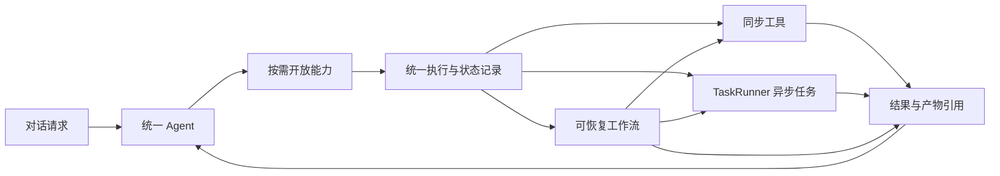

# 统一 Agent 开发方案

2026-11-06 文档能力后续改造：以 [文档可靠性与 PPT 增量改造开发规范](document-reliability-development.md) 为施工依据。该文档明确二十项设计决策、先交付 A 的范围、接口与验收；不代表功能已经实现。以下保留统一 Agent 的历史规划与阶段记录。

> **2026-11-09 状态更新（v2.3.5）**：文档可靠性的 A / B / C / D1 / D2 已完成，M1（对象映射）与 M2 第一刀（原位补丁：文字、样式、换图、图表、表格）已落地；真实渠道与 WPS 均已验收。当前代码结构见 [项目框架](architecture.md)，实现记录见开发规范第 13–26 节。

适用于 ChatCanvas 2.3.3 开发版。P0 和 P1 已通过本地回归，P2 默认渠道单次生图与两张一致性批量均已通过真实渠道冒烟；P3 已接入原生看图、单张改图、视频、音乐、配音、画布模板及 `set_canvas` / `optimize_prompt`，生图、一致性批量、配音、4 秒 480P 视频和 Suno 双曲音乐均已通过真实渠道任务验收。P4 已打通封面生成与 PPT 制作的素材交接。P5 已实现灰度入口、渠道级新对话默认、附件只进本轮，以及按意图预加载的能力组与 `capability_search` 按需开放；默认开启仍以真实渠道评测为准。

2026-11-05 更新：默认新 PPT 制作已切换到模板管线，用户已确认该切换。新管线通过虚构十章、十八章资料的真实模型验收。原生改图、WPS 十九页渲染、视觉模型三页审阅也已完成真实链路验收。公共注册表增加执行类型、能力版本、策略钩子与执行结果状态，工具操作和工作流有独立持久记录。当前仍为 2.3.3 开发版，按用户要求暂不打包或发布。详细结果见 [本轮验收记录](unified-agent-acceptance-2026-11-05.md)。

## 1. 产品目标与验收范围

将创作助手和普通聊天合为一个入口，保留原会话、消息和产物。用户可以在同一对话中提问、编辑文档、生成图片或音视频，以及提出需要组合多项能力的任务。输入框提供「全部能力」和「仅对话」。附件默认属于本轮，用户可显式将素材加入画布。无限画布助手保留独立工作范围，并复用工具执行与任务基础设施。

合并后的准确性以旧版为基线，按能力分别比较。普通聊天要能正常回答，创作要选对参数和素材，文档要产出能打开、内容符合要求的文件。任何一类发生回退都需要修正或继续使用旧路径。完整交付包含代码、故障恢复验证、真实渠道对比和分阶段发布开关。

## 2. 现有基础与复用位置

| 位置 | 当前职责 | 改造方向 |
| --- | --- | --- |
| `src/server/agent.ts` | 普通聊天原生循环、创作 JSON 循环、确认与等待任务 | 保留原路径作为迁移基线，逐步把已验收能力接入统一循环 |
| `src/server/chat-tools/registry.ts` | `ChatToolRegistry` 与文档工具契约 | 扩展执行类型、校验与策略元数据，按需提供工具定义 |
| `src/server/agent-tools.ts`、`agent-confirm.ts`、`agent-batch.ts` | 创作工具、确认预览、批量与一致性处理 | 复用实际执行和校验规则，在调用协议之外共享 |
| `src/server/tasks.ts`、`agent-task-events.ts` | `TaskRunner`、远程轮询与完成事件 | 继续负责单次异步任务，按操作 ID 投影到聊天卡片 |
| `src/server/db.ts` | 工具调用记录、轮次断点、PPT 阶段缓存 | 扩展操作状态和关联字段，持久化独立工作流进度 |
| `src/server/ai-presentation.ts`、`presentation-visual-review.ts` | PPT 策划、逐页审校与修补 | 封装为可暂停、可续做的工作流 |
| `src/server/brain.ts`、`agent-context.ts` | 模型协议解析和历史投影 | 统一内部调用表示，兼容旧历史和渠道差异 |
| `src/client/ChatView.tsx`、`chat/Composer.tsx` | 模式、附件、确认和任务卡交互 | 验收通过后切换为工具范围与显式素材操作 |

## 3. 执行模型

| 执行类型 | 选择条件 | 首批能力 | 恢复粒度 |
| --- | --- | --- | --- |
| 同步工具 | 一次受控操作就能返回结果 | 文件列表、分段读取、搜索、画布读取与版本校验后的编辑 | 操作结果或文件版本 |
| 异步任务 | 提交后等待一个任务结果，已有状态可查询 | 生图、改图、视频、音乐、配音 | 原任务 ID、远程任务 ID、结果素材 |
| 工作流 | 有多个依赖步骤，失败后需要定位并复用已完成步骤 | PPT 策划、逐页生成、审校、渲染与发布 | 运行 ID、步骤、页面、输入版本和阶段产物 |

以恢复粒度决定是否升级为工作流。耗时长的单次生图仍是异步任务。封面插画加 PPT 的请求由 PPT 工作流引用现有生图任务。简单表格统计可同步执行，分步清洗、计算、核验和导出需要分别恢复时再升级。



## 4. 能力注册与模型协议

扩展现有注册表。每个能力提供稳定名称和版本、输入校验、执行类型、渠道要求、资源范围、确认策略和执行函数。输入 schema 同时用于生成模型工具定义和服务端校验。渠道投影可以简化 schema，服务端保留完整校验。结果沿用 `ChatToolResult` 的摘要和卡片数据，在外层补充等待、暂停与恢复状态。

以下是接口草案，实施时与现有类型合并。

```ts
type ExecutionKind = "sync" | "task" | "workflow";

type ExecutionResult =
  | { state: "completed"; result: ChatToolResult }
  | { state: "awaiting_confirmation"; confirmationId: string }
  | { state: "waiting_task"; taskId: string }
  | { state: "waiting_workflow"; runId: string }
  | { state: "waiting_dependency"; operationId: string }
  | { state: "unknown_submit"; operationId: string }
  | { state: "cancel_requested"; operationId: string }
  | { state: "paused"; reasonCode: string; resumeId: string }
  | { state: "failed"; reasonCode: string; summary: string };

interface Capability<Input> {
  spec: BrainToolSpec;
  version: number;
  kind: ExecutionKind;
  validate(raw: unknown): Input;
  execute(input: Input, context: ExecutionContext): Promise<ExecutionResult>;
}
```

`ExecutionContext` 由服务器注入会话、消息、操作 ID、已解析资源、取消信号和进度回调。执行层在调用能力前落实权限、确认和预算。同步工具只需要返回结果，异步能力把执行委托给 `TaskRunner`，工作流通过公共运行记录和步骤状态恢复。工具的模型可见返回只包含执行所需数据，卡片只显示适合用户查看的字段。

状态查询统一读取持久记录。异步任务的恢复与取消交给 `TaskRunner`，工作流通过公共执行层恢复并调用当前步骤的处理函数。同步工具实现一次执行即可。

原生 Function Calling 与渠道兼容 JSON 路径分别解析成内部调用记录。记录保留协议、`tool_call_id`、本地操作 ID 和能力版本。原生一批调用暂停后，按原调用 ID 回填全部结果，再提交下一次模型请求。已有创作批量一致性语义通过「同一轮多个 `generate_image` 调用 + 每项 `consistency` 标记」保留：服务端合并成一张确认卡，确认后先生成基准图，其余以它为参考并行生成。其余并行调用仅在资源互不冲突时执行，依赖前一步结果的调用按顺序执行。

渠道能力按渠道配置版本、模型与具体能力记录，覆盖单调用、并行调用、流式参数、强制工具选择和 schema 限制。兼容协议在发起副作用之前选定。已有任务按其原任务 ID 恢复。提供原生工具能力受限时的可见提示，用户可切换支持所需能力的渠道。

渠道明确拒绝工具或工具选择参数时，按错误类型记录能力限制。返回 200 但缺少调用时，用无副作用的任务验证协议，再决定是否采用兼容路径。流式适配器按索引聚合片段，校验每个完整调用的 ID、名称和参数。schema 简化仍由服务端完整校验；渠道省略的默认值必须有明确规则。

## 5. 准确性与上下文

1. **按需开放工具。** 优先依据显式操作、附件类型、正在续做的任务和用户指令选择能力组。当前实现为 `core / docs / image / video / audio / templates / utility` 七组：确定性预加载 + `capability_search` 目录查找，查到的工具在下一轮注入；断点记录实际开放的 `activeTools`，恢复时不重新猜组。允许同一轮在创建文件或生成素材后开放相关后续工具。歧义场景先只读查找或向用户确认，尤其是收费操作和写入操作。
2. **以资源 ID 和版本绑定目标。** 「刚上传的图」优先解析为当前轮次附件。多个候选无法确定时展示可选目标。修改文档绑定文件 ID 和版本，修改画布绑定画布 ID 和版本。素材与文件的访问范围由执行层核对。
3. **缩短提示词。** 保留短的通用行为规则。工具参数写在 schema，业务边界写在执行校验，领域提示按能力加载。大文件通过文件 ID 和分页读取传递，工作流保存中间产物和来源引用。
4. **兼容历史投影。** 旧创作 JSON 计划、工具卡、普通文本和原生工具消息统一投影为模型能理解的历史。普通聊天正文保持自然语言。旧工具卡继续指向已有产物，确认中的旧任务按原执行路径完成。
5. **以真实结果判断完成。** 素材任务以实际任务成功和素材登记为准，文档以文件存在且可打开为准，PPT 内容与版式按核验记录展示。日志关联轮次、调用、操作、任务和产物 ID，记录失败阶段与原因，便于区分模型选错、参数错误和执行失败。

能力发现先预加载附件、文件和任务相关的只读能力。当前工具组不足时，按能力目录查找并在下一次模型调用中开放。明确的执行意图和有效参数才能进入操作校验；目标模糊时优先只读定位，涉及写入或收费且仍有多个候选时只问一个关键问题。工具数量与输入开销按基线评测调整。

看图结果携带经过访问校验的素材 ID。兼容适配器在原生工具结果回填后，按渠道的多模态消息格式提供图像，并用真实渠道核对模型是否能利用图像定位目标。多图情况下，编辑仍要求明确引用素材或向用户确认目标。

## 6. 操作状态、恢复与取消

沿用现有 SQLite。优先扩展原生调用和任务记录，新增独立的工作流运行、步骤与页面检查点记录。聊天轮次状态与操作状态分别保存，聊天断点保留待回填调用 ID 与操作引用，大体积输入和产物按 ID 引用。现有会话和消息继续原地使用。增量迁移应能在含旧任务的数据库上重复启动。

| 记录 | 必需字段 |
| --- | --- |
| 工具操作 | `operationId`、会话和轮次 ID、调用 ID、能力和版本、规范化参数、目标版本、状态、确认快照、任务或工作流引用、结果和时间戳 |
| 异步任务 | 沿用任务 ID、上游 ID、渠道和状态，增加操作 ID 关联与提交状态核对信息 |
| 工作流运行 | `runId`、会话 ID、能力版本、原始意图、文件和素材版本、模型及渠道配置指纹、状态、当前步骤、预算、已完成进度 |
| 工作流步骤 | 运行 ID、步骤 ID、输入指纹、尝试次数、状态、产物引用、已验证结果及错误原因 |

操作经历「已计划 → 待确认或可执行 → 执行中 → 成功、失败、暂停或取消」。需要等待时记录任务或工作流引用。外部提交结果未知时单独进入「提交状态待核对」。确认、领取执行和完成登记采用条件更新。多次点击确认、重复事件、两次恢复请求都只能推动一次相同状态转换。

轮次 ID 属于一次对话执行，模型调用 ID 在其响应内定位工具参数，操作 ID 标识一次实际执行。一个操作可关联多个下游任务，工作流运行关联按步骤编号保存的操作。跨能力依赖保存生产操作、目标步骤和带版本的 `assetId` 或 `fileId`。先复用现有文件与素材登记，采用版本校验和原子更新解决写入竞争。确有跨进程独占要求时再引入租约和对账。

原因码至少区分参数、权限、版本冲突、上游失败、预算、取消、提交未知和依赖失败。取消请求先持久化，再判断是否已经提交。确认领取、取消竞争和结果登记用短事务处理。远程提交在事务外进行。

| 场景 | 处理规则 |
| --- | --- |
| 用户确认后、提交前退出 | 恢复原操作，按持久状态判断是否已开始提交 |
| 上游接收、本地未保存远程 ID | 用上游幂等键重试同一操作，或用可查询的关联号找回任务。无法核实时等待用户核对 |
| 已有远程 ID、完成事件丢失 | 恢复轮询或查本地结果，更新同一张卡片 |
| 本地文件已写入、结果卡未更新 | 按操作 ID 找回已登记文件，补写结果 |
| 工作流预算耗尽或用户停止 | 保存已验证步骤，释放聊天轮次，从同一运行 ID 续做 |
| 目标文件、画布或渠道配置变化 | 执行前检查版本。冲突时提示重新选择目标或生成新的任务快照 |

相同参数可能代表用户明确要求再生成一次。去重按持久操作 ID 和确认记录执行，参数哈希用于比较快照和检查冲突。用户主动再生成会创建新的操作。对已提交远程任务，取消结果以渠道能力和查询结果为准。界面区分停止本地等待与上游确认取消。

## 7. PPT 工作流与预算

PPT 按每次执行分配 80 次模型调用和 200,000 tokens，累计用量跨续做保留。达到限制转为可续做的状态，并结束当前工具循环。任务卡显示触发项、已用量、已完成内容审校的页数和「继续 PPT」入口。续做绑定原资料、用户要求、模型配置和页面断点，由程序直接恢复。改了来源或交付要求时，发起新的制作任务，复用输入指纹仍匹配的阶段。

| 阶段 | 保存点 | 验收规则 |
| --- | --- | --- |
| 阅读与全局策划 | 资料版本、阅读摘要、来源编号、全局方案 | 来源覆盖完整，限定条件可追溯 |
| 页面目录与生成 | 页 ID、来源、页面方案和参考素材 | 结构通过校验，参数别名按明确规则归一 |
| 内容审校与修复 | 必修问题、建议、通过页、修补记录 | 建议允许交付，必修问题只返修受影响页 |
| 渲染与发布 | 渲染状态、视觉结果、文件与最终核验 | 保留原件和来源，明确可见的未检查项 |

内部结构化提交先校验预期工具名和结果数量。可明确判定为同一结果的重复提交可合并，不同结果只允许有限纠正。持续不兼容时切换该渠道已验证的格式，记录实际原因。PPT 内容阶段、视觉审阅与修补都应进入该任务用量统计。预算耗尽后同轮转成明确的暂停结果，避免反复拉起转换。

通用对话调用和时长、长工作流资源、付费生成额度分别计量。每次请求前检查剩余预算，返回后登记用量。渠道缺失 token 用量时明确显示未知，已启用严格 token 预算的任务按现有规则暂停。一次在途调用可能跨过剩余额度。继续任务时为本次运行分配新额度，并保留累计用量、原任务 ID 与断点。

当前 P0 每个会话保留最近一次预算暂停的 PPT。测试用 275 个主题的合成导图触发用量上限，关闭应用实例后从同一数据库续做。恢复跳过已通过的页面和阅读批次，并使用原操作 ID 登记文件。真实渠道与 WPS 视觉流程需要单独验收。

真实渠道 18 章长任务首次尝试时，内容审校驳回后模型自行创建 62 字节“封面骨架”并发起第二次转换，累计 44 次调用、约 38.8 万 tokens，已人工止损。随后补了宽松 JSON 解析、页面策划截断重试、最终审校格式重试、最终审校失败时保留已生成页面，以及“同一轮 doc_convert 失败后禁止自行换源重试”的硬闸门；该长任务尚未复测，不能标记为真实渠道通过。

### PPT 模板管线试用

新任务默认使用模板管线。需要回退时，设置 `CHATCANVAS_PPT_ENGINE=legacy` 并重启后端。设置为 `template` 或未设置都使用新管线。已暂停任务按创建时的管线恢复，没有引擎字段的旧检查点仍按 legacy 恢复。

新管线先规划全局叙事和页面来源，再分批提交简短的页面内容。版式由本地渲染器生成，输出原生文本、形状、表格、图表与图片。封面计入总页数。文字超出可读范围时移至备注，原图未排入页面时在项目内保留。内容审校只给建议，卡片区分已审校、部分审校和未审校。

通过校验的页面逐页保存。预算耗尽、有待补全页或精简页超过 20% 时，有可用正文就导出草稿。少量精简页可以直接交付，并从该版本的文件卡单独补做。补做生成新版本，保留原文件与其余页面。内容审校不可用时仍可交付，补审只更新指定版本的报告。

页数按本轮明确指令确定，模型给出的页数须有本轮原话作为依据。续做保留原任务页数。结构化请求首试最多 8192 个输出 tokens，截断后只重试未通过的页面，最多 16384，仍受渠道和工作流预算限制。

文件交付后由独立队列检查 WPS 渲染，按文件 ID 和 SHA-256 保存结果。后台检查前 20 页的渲染完整性及单色页，遇到超时或加载项不可用显示未检查，可单独重试。检查结果更新报告，文件可继续下载。

文件卡另有「视觉审校并修复」，需要开启看图并选择可接受图片的模型。这是显式模型操作，最多检查前 20 页，每页最多三个审阅轮次、两轮几何补丁。模型只能移动、缩放或调整样式，不能改写原文、表格数据、素材引用和来源。修补后重新渲染复查，完整复查结束后才另存新版本，原文件保持不变。未解决问题、部分检查和 WPS 不可用分别显示在版本报告中。重复操作会复用已生成的修复版本。

内容审校发现问题时，只对最多六张受影响页执行一次内容纠正，每批最多三页，随后单独复核这些页。失败时保留已生成页面与未解决问题，审校失败本身不阻断下载。文件卡允许单独补做精简页或审校指出问题的页。页数解析区分总页数和「每章一页」这样的分配规则。

`doc_convert.pageImages` 接收正文目标页和本会话真实素材 ID，封面与正文可以分别配图。已有 PPT 使用 `doc_edit.imageAssetIds` 引入新图片，再用实际图片索引安排页面。按页补做会保留显式正文配图。

本地固定十章验收运行 `npm test -- tests/presentation-workflow.test.ts`。覆盖精确页数、十章正文与备注、截断恢复、预算暂停、版本化补做和补审，以及 WPS 队列状态。固定评测脚本和真实新旧对照结果见本轮验收记录。

## 8. 接口与界面

当前新增接口与实现如下。

| 接口或模块 | 当前行为 |
| --- | --- |
| `ChatToolRegistry.execute` | 原生工具公共执行入口，保留领域完整校验，执行前策略钩子、执行后审计钩子，审计错误不会触发副作用重放 |
| `capability_executions` | 记录操作、能力版本、输入哈希、执行类型、任务/工作流引用、状态和原因码，不复制提示词或密钥 |
| `workflow_runs` / `workflow_steps` | 通用运行与已验证阶段产物记录，版本和输入指纹绑定，条件领取、取消、恢复，首个接入能力为 PPT |
| `GET /api/conversations/:id/executions` | 查询本会话最近的能力执行记录 |
| `GET /api/conversations/:id/workflows[/:runId]` | 查询运行、累计用量、状态与阶段产物摘要 |
| `POST /api/conversations/:id/workflows/:runId` | `resume` 继续原运行，`cancel` 取消并防止旧执行器继续写回。无法恢复的旧运行明确返回冲突 |
| `GET/POST /api/channels/:id/tool-protocol` | 按模型及渠道配置版本查询/检测单调用、多调用、流式、指定工具与嵌套参数。探测最多三次，只使用虚构数据，不执行返回的工具 |
| `POST .../presentation-status` | `page` 单页补做、`audit` 内容补审、`visual` 重试 WPS 检查、`review` 视觉审校与修复，全部绑定文件版本 |

渠道只拒绝 `tool_choice` 时仅停发该字段，不关闭整个工具能力。200 响应中没有有效调用属于未验证，不据此认定渠道不支持工具。DSML 恢复不会被认证为原生协议通过。模型设置展开模型后可查看能力记录，只有点击检测按钮才发出计费探测。

聊天工具卡显示工作流累计用量、已保存阶段产物和续做/取消入口。生成历史显式包含聊天生成图片并标记来源，公共画布素材筛选继续维持原有隔离。

复用现有会话消息、确认、停止和事件接口。增加按运行 ID 读取、继续或取消工作流的接口。接口以会话范围校验所有操作与任务，重复请求返回当前状态。长任务进度通过现有会话事件流投影，重连后先加载持久状态再接收增量。任务完成后更新原卡片，可以触发一次受预算约束的后续回复。旧结果对已更新的任务或新轮次只补充结果，避免改写当前意图。

确认卡显示实际动作、目标和参数。任务卡显示进行阶段、已完成项、错误或暂停原因、可继续的位置和结果链接。输入框按工具范围控制能力。灰度期间保留 `chatMode` 和原入口，统一入口通过独立开关开启。附件默认作为本轮参考，加入画布和首尾帧选择各有明确入口。画布助手仍通过自己的会话和节点范围运行。

「仅对话」只使用本轮可直接提供给模型的文本和图像上下文。需要工具读取的附件由用户切换到「全部能力」处理。跨轮素材可从历史附件或素材库显式引用。无限画布的现有协议在本期继续使用。PPT 暂停时先交付进度与续做入口，草稿下载在用户确有需求时独立验收。

## 9. 实施顺序与退出条件

| 阶段 | 实现内容 | 通过条件 |
| --- | --- | --- |
| P0 建立基线并修 PPT | 冻结回归样本，完善 PPT 暂停、进度、续做和错误分流 | 275 行级导图场景耗尽预算后不重复调用，继续后只处理未完成阶段，最终产物可打开 |
| P1 共享执行层 | 扩展注册表与操作状态，把现有创作规则接入共享执行入口，保留原界面 | 生图、视频确认、历史卡和文档路径通过原有回归，旧数据可打开，升级中断可恢复 |
| P2 原生生图灰度 | 为生图接入原生工具调用，先在选定渠道开启 | 实际渠道通过单图、多参考图、批量一致性、确认、取消、断网、重启和完成回报场景 |
| P3 迁移其他能力 | 分批迁移改图、视频、音乐、配音、模板，补齐渠道兼容 | 每个能力各自达到基线。图像引用和音视频任务结果能从同一会话稳定取得 |
| P4 跨能力交付 | PPT 工作流消费生图任务产出的素材 ID，保持资源和任务依赖关系 | 同一指令生成封面并嵌入真实 PPTX。断在生图完成与 PPT 开始之间时，恢复复用原图 |
| P5 统一入口 | 按会话和渠道灰度，验证通过后默认启用「全部能力 / 仅对话」 | 旧会话、旧消息和待完成任务可访问，关键指标达到基线，支持开关回退 |

回退开关影响新轮次。已提交的任务继续从原操作和任务记录取得结果，进行中的工作流按保存的版本继续或提示升级冲突。部署时先升级读取和状态兼容，再逐步开放新执行路径。进入下一阶段依据验收结果决定。

升级时保留旧任务的执行路径，活跃运行需要兼容其能力版本，或提供明确且可重复执行的迁移。旧原生调用记录保持可查，确有新执行需要时再建立关联。旧工具名称用于历史投影，参数语义不同的旧调用不直接转换为新工具。回退以执行开关为单位，数据库迁移按前向兼容设计。

P1 已将创作操作 ID 与任务一起落库，确认时在同一事务中领取确认卡并保存批准或拒绝的参数快照。启动后可以按操作 ID 找回已入库的任务并补回原卡片。提交期间断开连接，或重启时缺少上游任务 ID，进入提交未知状态并停止当前轮续跑。依赖未知基准图的生成暂不提交。P2 接入原生生图时复用这些确认、提交与恢复规则，并对比旧路径的参考图、批量和渠道行为。

P2 从普通聊天中的单次生图开始，试用默认关闭，可在输入区开启「创作试用」。生图工具使用原生 Function Calling。确认卡记录模型、渠道版本、请求参数、参考图 ID 与待回填的工具调用。新消息会替换旧的试用确认。应用重启后仍可确认未提交的原请求。结果回填原调用 ID，同时保留可引用的素材 ID。

真实渠道已通过单次参考图生图冒烟验收。使用默认对话模型 `deepseek-v4.1-flash-1017` 和默认生图模型 `gemini-3.1-flash-image`，输入为合成的几何图形。确认卡绑定了该附件，确认前任务数为 0，确认接口首次返回 200、重复确认返回 409。最终生成任务和上游请求各 1 次，图片已保存，助手收到结果后回复。该结果覆盖当前默认渠道组合的单次调用，批量一致性和其他渠道分别验收。

P3 的图片能力已增加 `view_images` 和 `edit_image`。看图只读取明确指定的会话图片，缩略图在所有工具结果回填后附给模型。渠道拒绝图片输入时，本轮降级为文字并告知模型图片未送达。改图固定一张底图与所选额外参考图，确认后若素材丢失则停止，避免少图提交。本地端到端测试验证了历史图回传、两张参考素材绑定、确认前零提交与原调用 ID 回填。真实改图及其他创作能力继续按阶段验收。

P3 的 `generate_video` 使用同一个试用开关。确认卡锁定模型、视频模式和参考图角色，沿用已有视频参数控件。确认后只提交一次，交给 TaskRunner 后台执行。任务完成时更新原卡片，保留视频素材引用。会话仍在等这条任务时，成功结果回填到原工具调用并续跑；用户已开启新一轮时只更新任务卡。应用重启会补收已完成的任务。当前通过本地模拟渠道验收，真实视频渠道待验收。

P3 的 `generate_music` 和 `generate_speech` 沿用同一套确认、后台等待和结果回填。音乐锁定源歌曲的会话素材 ID，完成后保留每首歌的产物引用。配音卡显示正文及所选音色，双人正文统一为逐行 `A：`、`B：`，提交时分别映射音色。`create_canvas_template` 和 `create_storyboard_template` 生成模板卡，分镜沿用现有审阅流程，用户选择目标画布后导入。模板创建不提交生成任务。音乐、配音和模板已在本地模拟环境回归，真实音频渠道待验收。升级时已提交的任务仍会更新原卡片，自动回报依赖于原调用所用工具定义与当前版本匹配。

P4 的 `doc_convert.coverAssetId` 接受本会话的图片 ID。用户可指定已有封面，或在同一条指令中要求先生成封面再制作 PPT。原生生图和改图确认后通过 TaskRunner 在后台执行，完成时原工具结果和续跑断点一并保存。PPT 启动后保存文件与封面引用并核对内容指纹，恢复时复用同一张图。导出的首页嵌入 PNG 或 JPEG，嵌入体积上限 4 MB，标题和副标题仍是原生文本框。模拟验收覆盖生图完成后重启、PPT 超预算后续做，并校验首页所嵌入图片的实际字节与生图产物一致。真实渠道及 WPS 视觉效果待验收。

P5 在聊天输入区的模式菜单增加「统一助手试用」。启用后可切换「全部能力」「仅对话」或「返回旧入口」，保留原模式设置和历史。模型设置中的「新对话试用」只影响新建时选用该渠道的会话。现有会话独立选择工具范围。仅对话只发送直接可读的上下文，禁止执行工具或续做 PPT。全部能力复用原生工具注册表，渠道明确拒绝工具时回退为文字回答，换模型后可重试。旧确认卡保留原有的确认与渠道校验，已提交任务继续更新原卡片。

统一入口的上传和选择仅作为本轮附件。素材库提供显式「加入无限画布」。在全部能力下右键本轮已选素材可设置视频首尾帧，服务端校验素材属于本会话，确认卡按所选角色固定参数。模拟回归覆盖渠道灰度、保留旧历史、工具拒绝及模型切换、仅对话拒绝执行异常工具调用、切换范围后的旧确认卡，以及统一入口下封面和 PPT 断点恢复。

## 10. 回归、真实渠道评测与上线门槛

在同一模型、渠道配置、任务输入和素材下对比旧版与新版。保留原始工具轨迹、产物与人工判定。模型输出存在波动的场景重复运行，并按能力分别报告结果。PPT 用合成资料重现长导图、结构化调用重复、内容错误与预算耗尽。模型调用的外部测试使用获准的资料。

| 验收类别 | 必测场景与判定 |
| --- | --- |
| 意图与目标 | 闲聊无误执行，明确生成选择正确工具，模糊目标触发恰当追问，附件与素材 ID 对得上 |
| 参数与权限 | 缺参数、错误枚举、渠道忽略参数、跨会话 ID、过期文档或画布版本均得到明确结果 |
| 协议 | 原生单调用和多调用、流式分片、调用 ID 异常、结构化提交重复、渠道拒绝工具、兼容路径执行前切换 |
| 提交与恢复 | 双击确认、并发领取、上游接收后掉线、提交前重启、完成事件重复或丢失、取消与完成竞争 |
| 文档与视觉 | PPT 页数、关键事实和条件、实际图片嵌入、可编辑性、WPS 可用时的视觉核验和断点复用 |
| 交互与兼容 | 旧会话混合历史、旧确认卡、仅对话、附件显式进画布、异步完成后刷新与重连 |
| 跨能力负路径 | 生图失败或取消、素材重复、PPT 先耗尽预算。消费方保留依赖状态并给出可执行下一步 |
| 开销 | 每个场景记录模型调用次数、输入输出 tokens、任务提交数和从请求到产物的耗时 |

上线门槛按能力计算。工具选对率、素材引用准确率与交付成功率应达到同渠道旧版基线。故障注入中出现未经授权的付费提交、重复提交、错改资源或无法恢复的进度丢失时，停止该能力灰度。开销与延迟用 P0 实测结果设阈值，跨能力任务单独统计。自动测试通过后仍需实际渠道验证流式返回、费用提交与恢复语义。

补测过度追问、渠道静默忽略工具、旧任务升级后恢复、并行写同一资源、取消与提交竞争。关键场景可先重复三次做冒烟验证，质量上线门槛使用实际基线样本量评估，不按小样本的百分点波动判定。

## 11. 新能力接入清单

1. 写清用户意图、输入与产物，选择同步工具、异步任务或工作流。
2. 注册 schema、能力版本、资源范围、确认策略和渠道要求。
3. 复用已有文件、素材和任务 ID。涉及修改时校验目标版本。
4. 提供可供聊天引用的结果与可展示的任务卡数据。工作流额外声明保存点、依赖和恢复校验。
5. 加入正确路由、错误目标、失败与恢复的验收用例，登记真实渠道验证范围。

例如给视频添加字幕可以由工作流负责转录、校对时间轴和导出。转录若本身是一个远程任务，直接复用异步执行接口。新增能力经过注册与执行层接入，供现有 Agent 在需要时调用。
